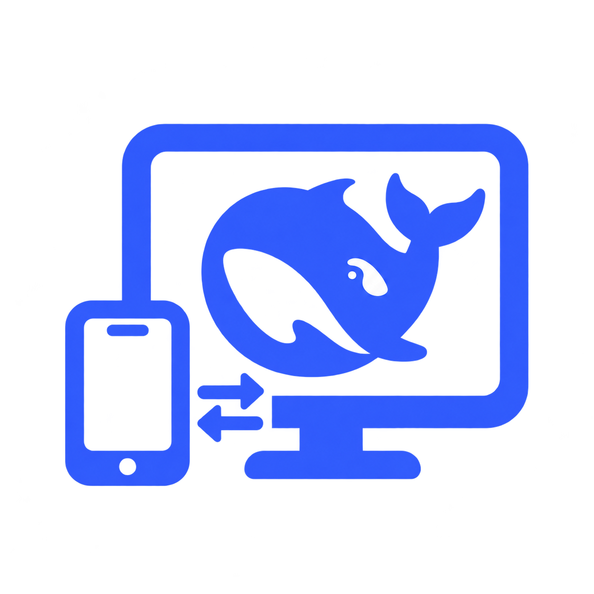
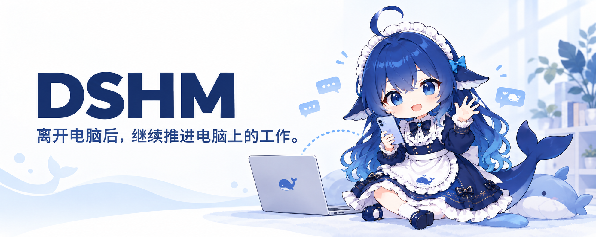
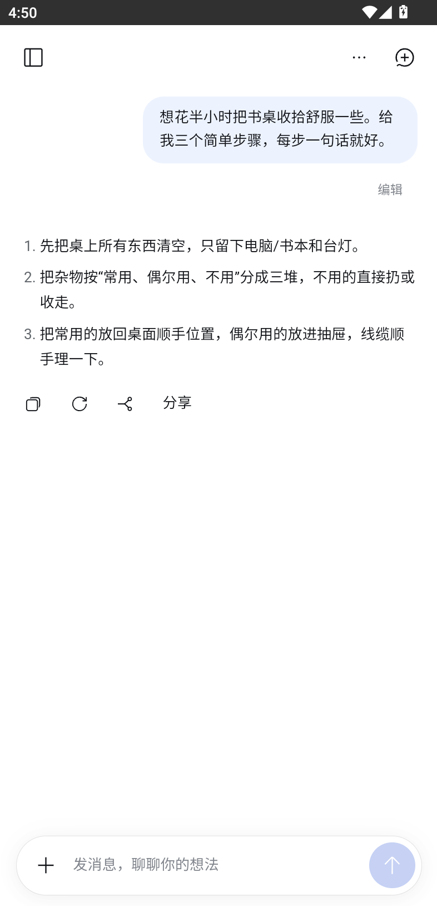
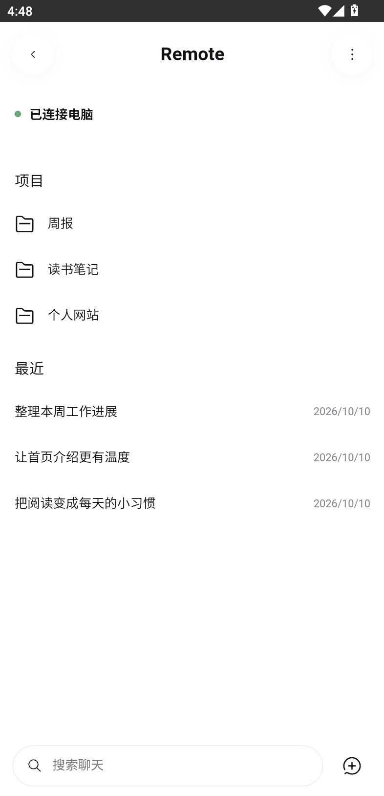
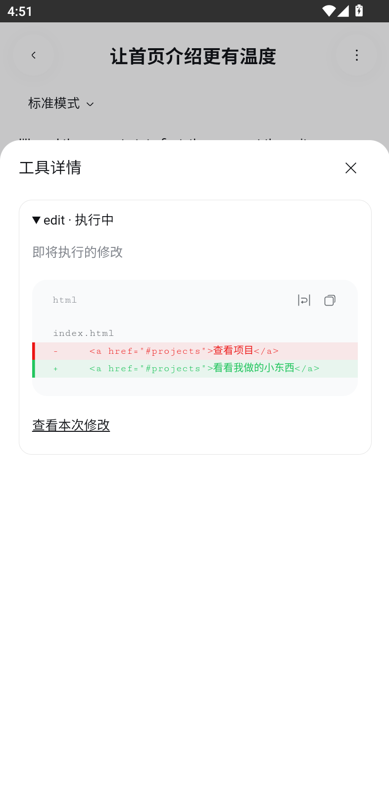
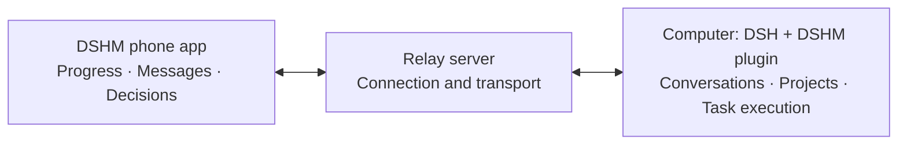

# DeepSeek Harness Mobile (DSHM)

[简体中文](./README.md) | English

**DSHM Android app** · [DSHM desktop plugin](https://github.com/KKUCODES/dshm-plugin/blob/main/README.en.md) · [DSHM relay server](https://github.com/KKUCODES/dshm-relay/blob/main/README.en.md)

**DSHM** is a community-developed Android client for [DeepSeek Harness (DSH)](https://github.com/deepseek-ai/deepseek-harness). Chat directly with DeepSeek or synchronize DSH conversations from your computer. Away from your desk, you can keep sending messages, viewing execution results, switching models, and handling approvals; the computer runs the tasks.

[Download preview.22 for Android](https://github.com/KKUCODES/deepseek-harness-mobile/releases/download/v0.1.0-preview.22/DSHM-0.1.0-preview.22.apk) · [Connect to computer DSH](#connect-to-deepseek-harness-on-your-computer) · [Usage guide (Chinese)](./docs/usage.md) · [FAQ](#faq)

<p align="center">
  
</p>



## Direct chat and Remote screenshots

<table>
  <tr>
    <th width="33%">Everyday conversations</th>
    <th width="33%">Continue your projects</th>
    <th width="33%">Review before approving</th>
  </tr>
  <tr>
    <td><a href="./docs/images/ordinary-chat.png"></a></td>
    <td><a href="./docs/images/remote-sessions.png"></a></td>
    <td><a href="./docs/images/remote-approval.png"></a></td>
  </tr>
</table>

[Image sources (Chinese)](./docs/images/README.md). Screenshots show the Simplified Chinese interface; click to view full size.

## Mobile chat and remote session features

| Capability | What you can do |
| --- | --- |
| Direct chat | Connect to DeepSeek or custom OpenAI Chat Completions compatible providers, with separate keys and models, streaming replies, reasoning, attachments, local history and backups. |
| Remote | Open existing workspaces and conversations, or start a new chat in an existing workspace. Send messages, switch models, stop tasks, answer questions, and handle approvals. |
| Results | View tools, command output, files, and changes; save or share complete files. |
| Plugin interfaces | Display compatible plugins. Proportional scaling is enabled by default; plugin declarations and user settings can adjust it. |



The published preview.22 APK includes the Remote home and connection-page plugin (0.7.1). Manage it under **Plugins → Phone**. Updating the app keeps your installed version and preferences. [Phone plugin guide (Chinese)](./docs/plugins/development.md)

## Download the Android APK and get started

[Download the signed preview.22 APK](https://github.com/KKUCODES/deepseek-harness-mobile/releases/download/v0.1.0-preview.22/DSHM-0.1.0-preview.22.apk) · [Release and checksums](https://github.com/KKUCODES/deepseek-harness-mobile/releases/tag/v0.1.0-preview.22)

On Android 9 or later, open the downloaded APK and confirm installation. If Android prompts you, allow the app you used to open the file to install it. To upgrade an earlier official preview, install over the existing app to keep your chats, settings and pairing. [APK installation guide (Chinese)](./docs/releases.md)

Install the app and configure your own DeepSeek API key, or add a compatible service under Settings → Direct chat → Manage providers and models. Your phone connects directly to the selected provider and history stays on the device. No computer or Remote relay is needed.

### Connect to DeepSeek Harness on your computer

1. On your computer, install [DSHM desktop plugin `0.1.88-latest.0`](https://github.com/KKUCODES/dshm-plugin/releases/tag/v0.1.88-latest.0) in official DSH `0.2.2-rc.3`. Restart DSH Web to load it, register the computer with the relay, enable the connection, and generate a one-time pairing link.
2. On your phone, open **Remote** in preview.22. Scan the QR code on the computer or paste the full link, check the device name, and tap **Continue pairing**. The link expires after five minutes and can be claimed once.
3. Compare the phone’s public-key fingerprint with the one shown in the desktop plugin. If they match, approve the device on the computer. Keep Remote open. It connects automatically and loads your workspaces and sessions.

**[Hosting your own relay](https://github.com/KKUCODES/dshm-relay/blob/main/README.en.md) is recommended.** You can also use the [public service](http://118.31.20.47:18787): `http://118.31.20.47:18787`. Open registration requires no enrollment token; phone pairing and computer approval are still required.

The public service uses HTTP, so transport is unencrypted. Use a self-hosted HTTPS relay for sensitive content. Direct chat does not use the relay. See the [usage guide (Chinese)](./docs/usage.md) for full instructions.

## Current status

**preview.22** builds on preview.21 with community PR #1: workspace chat groups, local Markdown images and preview zoom. It fixes image paths, failed-read recovery, cached tool arguments and the oldest-page anchor. Checked in MuMu; the original intermittent field reports still need verification. See the [release notes](./ci/release-notes/0.1.0-preview.22.md) and [scope and validation (Chinese)](./docs/integration/preview22-pr1-current.md).

Tested Remote combination: Android `0.1.0-preview.22`, desktop plugin `0.1.88-latest.0`, and official DSH `0.2.2-rc.3`. For other versions, check the [desktop compatibility report (Chinese)](https://github.com/KKUCODES/dshm-plugin/blob/main/compatibility/latest-upstream/official-support.md).

### Earlier previews

**preview.21** fixes competing Remote history anchors, a final-page position shift, and a missing sending-state guard. The reported intermittent scenarios still need field verification. See the [release notes](./ci/release-notes/0.1.0-preview.21.md) and [diagnostics guide (Chinese)](./docs/integration/diagnostics-current.md).

**preview.16** improves Remote reconnection when the app returns to the foreground, shows cached messages when reopening recent chats, and fixes a draft recovery error. See the [validation scope (Chinese)](./docs/integration/preview16-remote-resume.md), [release notes](./ci/release-notes/0.1.0-preview.16.md) and [build and download guide (Chinese)](./docs/releases.md).

The [public phone interface API (Chinese)](./docs/plugins/remote-home-api.md) provides home and connection-page surfaces, with default views when a plugin is disabled, removed or fails. The connection-page surface requires preview.15 or later. See the [plugin author guide (Chinese)](./docs/plugins/development.md).

**preview.14** adds independent home plugins and unified phone plugin management. It fixes phone-light/desktop-dark home colors and restores original Figma icons, while preserving official plugin history-loading failure behavior. See the [release notes](./ci/release-notes/0.1.0-preview.14.md) for scope and validation limits.

**preview.12** adds bounded history windows, bidirectional browsing, viewport rendering and recovery. Computer history is retained. See the [implementation and validation limits (Chinese)](./docs/integration/remote-history-window-current.md).

**preview.13** adds [automatic history loading near the top (Chinese)](./docs/integration/remote-history-window-current.md#触顶自动加载). Scrolling upward loads one batch while preserving the reading position and window budgets; manual retry remains available after a failure.

Web links in Remote chat and Markdown file previews open through the system browser while project files keep their in-app previews. See the [validation scope (Chinese)](./docs/integration/remote-links-diagnosis.md). These fixes require an APK update; older page resources do not include the new native capabilities.

**preview.11** unifies software updates into one status card and primary action for downloading, installing or “Restart and apply.” Notes and technical details are collapsible; drafts are saved before restarting. See the [implementation and validation scope (Chinese)](./docs/integration/unified-updates-current.md).

The earlier `0.1.80-latest.0` plugin and DSH `0.2.1-alpha.2` combination has its own [Web and MuMu validation record (Chinese)](https://github.com/KKUCODES/dshm-plugin/blob/main/compatibility/latest-upstream/official-support.md).

Supports [signed full page-resource updates (Chinese)](./docs/integration/web-resource-updates-current.md): compatibility checks, full launch activation, rollback and native recovery. Native changes still require an APK. This release publishes the APK only; r2 is deferred. Earlier back-gesture, in-app update and large-response fixes remain. Users on preview.8 or newer can update in the app; earlier versions need a manual installation.

The [historical compatibility record (Chinese)](./docs/integration/market-baseline.md) covers earlier DSH versions. Direct chat retains custom providers and models. [Provider guide (Chinese)](./docs/integration/ordinary-providers-current.md)

### Platform and Remote limits

- Android only for the first version. Physical devices, the complete public-network path, and other versions, plugins, and models still need validation.
- Keep the computer and DSH running. Install the standalone plugin; no DSH core modifications are needed.
- The phone does not create computer workspaces, accept manually entered commands, or forward computer localhost websites.
- Notifications stop when the app process ends. Reopening the app attempts to reconnect.

## FAQ

### How is Remote different from opening DSH in a phone browser?

Remote uses the DSHM chat interface bundled with the app and synchronizes computer conversations and actions through the relay. You view execution progress, file changes, and approvals in the phone's own pages. Computer DSH executes the tasks; the phone and computer participate in the same conversation.

### Do I need to enter a DeepSeek API key on my phone for Remote?

No phone direct-chat key is required. Remote uses the models and credentials configured in computer DSH, after pairing and computer approval. Direct chat uses your provider's API key configured on the phone; the modes are managed separately.

### Where are direct-chat and Remote histories stored?

Direct-chat history and drafts stay on the phone and can be exported through local backups. Remote connects to conversations stored by computer DSH. The histories are managed separately and are not merged when you switch modes. See [history and backups (Chinese)](./docs/usage.md#历史与备份).

### Is there an iPhone version?

Only the Android development preview is available, for Android 9 or newer. No iPhone version is available yet.

## Development and documentation

Kotlin + WebView, with a React chat interface that reuses DSH client components. Pages are bundled with the app. GitHub Actions prepares pinned SDK packages and read-only official source automatically; existing local development commands still use adjacent projects. See the [build and release guide (Chinese)](./docs/releases.md).

```text
android/     Android project and native bridge
src/         Direct chat, Remote, and shared interfaces
scripts/     Build, validation, and integration scripts
tests/       Tests and fixtures
docs/        Usage, development, and technical documentation
```

Detailed guides are currently in Chinese:

- [Usage guide](./docs/usage.md): direct chat, pairing, and limitations.
- [Development guide](./docs/development.md): environment, builds, and tests.
- [Remote caching (Chinese)](./docs/integration/remote-cache-current.md) documents the original cache implementation and its validation.
- [Builds and downloads](./docs/releases.md): automatic signing, public APKs, checksums, and version metadata.
- [In-app updates (Chinese)](./docs/integration/app-updates-current.md): verified downloads, Android installation, Markdown release notes and specific validation errors.
- [Compatibility report](https://github.com/KKUCODES/dshm-plugin/blob/main/compatibility/latest-upstream/official-support.md): versions and support scope.
- [Knowledge catalog](./docs/project-knowledge/catalog.md): architecture, design, and validation evidence.
