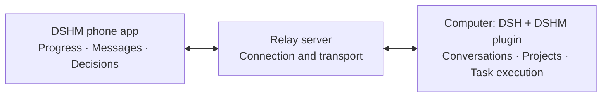

# DeepSeek Harness Mobile (DSHM)

[简体中文](./README.md) | English

**Android app** · [Desktop plugin](https://github.com/KKUCODES/dshm-plugin/blob/main/README.en.md) · [Relay server](https://github.com/KKUCODES/dshm-relay/blob/main/README.en.md)

<p align="center">
  
</p>


An Android chat client for DeepSeek Harness, named **DSHM** in the app. Chat directly with your own DeepSeek API key, or connect to DSH on your computer and continue the same conversation. The computer runs tasks; your phone lets you follow progress, send messages, and make decisions.

## Screenshots

<table>
  <tr>
    <th width="33%">Everyday conversations</th>
    <th width="33%">Continue your projects</th>
    <th width="33%">Review before approving</th>
  </tr>
  <tr>
    <td><a href="./docs/images/ordinary-chat.png"></a></td>
    <td><a href="./docs/images/remote-sessions.png"></a></td>
    <td><a href="./docs/images/remote-approval.png"></a></td>
  </tr>
</table>

[Image sources (Chinese)](./docs/images/README.md). Screenshots show the Simplified Chinese interface; click to view full size.

## Features

| Capability | What you can do |
| --- | --- |
| Direct chat | Connect directly to DeepSeek from your phone, with streaming replies, deep thinking, attachments, local history, and backups. |
| Remote | Open existing workspaces and conversations, or start a new chat in an existing workspace. Send messages, switch models, stop tasks, answer questions, and handle approvals. |
| Results | View tools, command output, files, and changes; save or share complete files. |
| Plugin interfaces | Display compatible plugins. Proportional scaling is enabled by default; plugin declarations and user settings can adjust it. |



## Get started

[Download APK](https://github.com/KKUCODES/deepseek-harness-mobile/releases/download/v0.1.0-preview.1/DSHM-0.1.0-preview.1.apk) · [Build and signing guide (Chinese)](./docs/releases.md) · [GitHub Actions](https://github.com/KKUCODES/deepseek-harness-mobile/actions/workflows/android-build.yml) · [Releases](https://github.com/KKUCODES/deepseek-harness-mobile/releases)

The public development preview provides a signed APK for Android 9 or newer. Install the `.apk` from Releases, or download `dshm-signed-apk` from a successful build. Unsigned PR artifacts are for build checks only.

- **Direct chat:** Install the app and configure your own DeepSeek API key. History stays on your phone; no computer is needed.
- **Remote:** Install the [companion plugin](https://github.com/KKUCODES/dshm-plugin/blob/main/README.en.md) in DSH on your computer and connect it to a relay. Claim a one-time pairing link on your phone, then verify its fingerprint and approve it on the computer.

**[Hosting your own relay](https://github.com/KKUCODES/dshm-relay/blob/main/README.en.md) is recommended.** You can also use the [public service](http://118.31.20.47:18787): `http://118.31.20.47:18787`. Open registration requires no enrollment token; phone pairing and computer approval are still required.

The public service uses HTTP, so transport is unencrypted. Use a self-hosted HTTPS relay for sensitive content. Direct chat does not use the relay. See the [usage guide (Chinese)](./docs/usage.md) for full instructions.

## Current status

Development preview; not an app-store release. Core Remote features passed local Web + MuMu validation with **official DSH `0.2.1-alpha.2` + plugin `0.1.80-latest.0` + the matching Android app**. See the [compatibility report (Chinese)](https://github.com/KKUCODES/dshm-plugin/blob/main/compatibility/latest-upstream/official-support.md) for the supported scope.

- Android only for the first version. Physical devices, the complete public-network path, and other versions, plugins, and models still need validation.
- Keep the computer and DSH running. Install the standalone plugin; no DSH core modifications are needed.
- The phone does not create computer workspaces, accept manually entered commands, or forward computer localhost websites.
- Notifications stop when the app process ends. Reopening the app attempts to reconnect.

## Development and documentation

Kotlin + WebView, with a React chat interface that reuses DSH client components. Pages are bundled with the app. GitHub Actions prepares pinned SDK packages and read-only official source automatically; existing local development commands still use adjacent projects. See the [build and release guide (Chinese)](./docs/releases.md).

```text
android/     Android project and native bridge
src/         Direct chat, Remote, and shared interfaces
scripts/     Build, validation, and integration scripts
tests/       Tests and fixtures
docs/        Usage, development, and technical documentation
```

Detailed guides are currently in Chinese:

- [Usage guide](./docs/usage.md): direct chat, pairing, and limitations.
- [Development guide](./docs/development.md): environment, builds, and tests.
- [Builds and downloads](./docs/releases.md): automatic signing, public APKs, checksums, and version metadata.
- [Compatibility report](https://github.com/KKUCODES/dshm-plugin/blob/main/compatibility/latest-upstream/official-support.md): versions and support scope.
- [Knowledge catalog](./docs/project-knowledge/catalog.md): architecture, design, and validation evidence.
