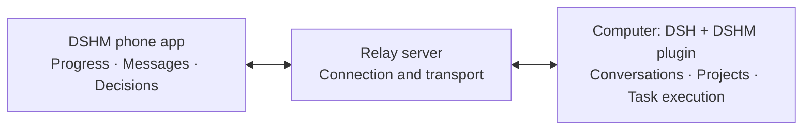

# DeepSeek Harness Mobile (DSHM)

[简体中文](./README.md) | English

**DSHM Android app** · [DSHM desktop plugin](https://github.com/KKUCODES/dshm-plugin/blob/main/README.en.md) · [DSHM relay server](https://github.com/KKUCODES/dshm-relay/blob/main/README.en.md)

**DSHM** is a community-developed Android client for [DeepSeek Harness (DSH)](https://github.com/deepseek-ai/deepseek-harness). Chat directly with DeepSeek or synchronize DSH conversations from your computer. Away from your desk, you can keep sending messages, viewing execution results, switching models, and handling approvals; the computer runs the tasks.

[Download Android APK](https://github.com/KKUCODES/deepseek-harness-mobile/releases/download/v0.1.0-preview.7/DSHM-0.1.0-preview.7.apk) · [Connect to computer DSH](#connect-to-deepseek-harness-on-your-computer) · [Usage guide (Chinese)](./docs/usage.md) · [FAQ](#faq)

<p align="center">
  
</p>


## Direct chat and Remote screenshots

<table>
  <tr>
    <th width="33%">Everyday conversations</th>
    <th width="33%">Continue your projects</th>
    <th width="33%">Review before approving</th>
  </tr>
  <tr>
    <td><a href="./docs/images/ordinary-chat.png"></a></td>
    <td><a href="./docs/images/remote-sessions.png"></a></td>
    <td><a href="./docs/images/remote-approval.png"></a></td>
  </tr>
</table>

[Image sources (Chinese)](./docs/images/README.md). Screenshots show the Simplified Chinese interface; click to view full size.

## Mobile chat and remote session features

| Capability | What you can do |
| --- | --- |
| Direct chat | Connect to DeepSeek or custom OpenAI Chat Completions compatible providers, with separate keys and models, streaming replies, reasoning, attachments, local history and backups. |
| Remote | Open existing workspaces and conversations, or start a new chat in an existing workspace. Send messages, switch models, stop tasks, answer questions, and handle approvals. |
| Results | View tools, command output, files, and changes; save or share complete files. |
| Plugin interfaces | Display compatible plugins. Proportional scaling is enabled by default; plugin declarations and user settings can adjust it. |



## Download the Android APK and get started

[APK releases](https://github.com/KKUCODES/deepseek-harness-mobile/releases) · [Build and signing guide (Chinese)](./docs/releases.md) · [GitHub Actions builds](https://github.com/KKUCODES/deepseek-harness-mobile/actions/workflows/android-build.yml)

The public development preview provides a signed APK for Android 9 or newer. Download the `.apk` directly from Releases without a GitHub account. Downloading `dshm-signed-apk` from Actions requires sign-in. See the [APK build and download guide (Chinese)](./docs/releases.md) for signing and updates.

Install the app and configure your own DeepSeek API key, or add a compatible service under Settings → Direct chat → Manage providers and models. Your phone connects directly to the selected provider and history stays on the device. No computer or Remote relay is needed.

### Connect to DeepSeek Harness on your computer

1. Install the [DSHM remote connection plugin](https://github.com/KKUCODES/dshm-plugin/blob/main/README.en.md) in official DSH on your computer and connect it to a relay.
2. Claim the computer's one-time pairing link in DSHM on your phone.
3. Verify the device fingerprint and approve it on the computer. Then open an existing workspace on your phone to continue a conversation or create a new chat.

**[Hosting your own relay](https://github.com/KKUCODES/dshm-relay/blob/main/README.en.md) is recommended.** You can also use the [public service](http://118.31.20.47:18787): `http://118.31.20.47:18787`. Open registration requires no enrollment token; phone pairing and computer approval are still required.

The public service uses HTTP, so transport is unencrypted. Use a self-hosted HTTPS relay for sensitive content. Direct chat does not use the relay. See the [usage guide (Chinese)](./docs/usage.md) for full instructions.

## Current status

Development preview; not an app-store release. Core Remote features passed local Web + MuMu validation with **official DSH `0.2.1-alpha.2` + plugin `0.1.80-latest.0` + the matching Android app**. See the [compatibility report (Chinese)](https://github.com/KKUCODES/dshm-plugin/blob/main/compatibility/latest-upstream/official-support.md) for the supported scope.

**preview.7** fixes oversized Remote responses across initial snapshots, history pages and large live events, with fresh reads after reconnect. Update the plugin to `0.1.87-latest.0` and self-hosted relays to include protocol commit `94183d0`. See the [fix and validation scope (Chinese)](./docs/integration/remote-response-chunks.md).

[0.1.0-preview.7](https://github.com/KKUCODES/deepseek-harness-mobile/releases/tag/v0.1.0-preview.7) retains custom direct-chat providers, models, existing DeepSeek settings and chats. See [provider details (Chinese)](./docs/integration/ordinary-providers-current.md). Remote requires desktop plugin `0.1.87-latest.0`; core connections were tested with official DSH `0.2.0-rc.2` / `0.2.1-alpha.2` / `0.2.1-rc.2`; see the [validation scope (Chinese)](./docs/integration/market-baseline.md). The identity and signature are unchanged: install over preview.1–preview.6 to retain local data.

- Android only for the first version. Physical devices, the complete public-network path, and other versions, plugins, and models still need validation.
- Keep the computer and DSH running. Install the standalone plugin; no DSH core modifications are needed.
- The phone does not create computer workspaces, accept manually entered commands, or forward computer localhost websites.
- Notifications stop when the app process ends. Reopening the app attempts to reconnect.

## FAQ

### How is Remote different from opening DSH in a phone browser?

Remote uses the DSHM chat interface bundled with the app and synchronizes computer conversations and actions through the relay. You view execution progress, file changes, and approvals in the phone's own pages. Computer DSH executes the tasks; the phone and computer participate in the same conversation.

### Do I need to enter a DeepSeek API key on my phone for Remote?

No phone direct-chat key is required. Remote uses the models and credentials configured in computer DSH, after pairing and computer approval. Direct chat uses your provider's API key configured on the phone; the modes are managed separately.

### Where are direct-chat and Remote histories stored?

Direct-chat history and drafts stay on the phone and can be exported through local backups. Remote connects to conversations stored by computer DSH. The histories are managed separately and are not merged when you switch modes. See [history and backups (Chinese)](./docs/usage.md#历史与备份).

### Is there an iPhone version?

Only the Android development preview is available, for Android 9 or newer. No iPhone version is available yet.

## Development and documentation

Kotlin + WebView, with a React chat interface that reuses DSH client components. Pages are bundled with the app. GitHub Actions prepares pinned SDK packages and read-only official source automatically; existing local development commands still use adjacent projects. See the [build and release guide (Chinese)](./docs/releases.md).

```text
android/     Android project and native bridge
src/         Direct chat, Remote, and shared interfaces
scripts/     Build, validation, and integration scripts
tests/       Tests and fixtures
docs/        Usage, development, and technical documentation
```

Detailed guides are currently in Chinese:

- [Usage guide](./docs/usage.md): direct chat, pairing, and limitations.
- [Development guide](./docs/development.md): environment, builds, and tests.
- [Remote caching (Chinese)](./docs/integration/remote-cache-current.md): resource revalidation, incremental synchronization and measured scope; pair with plugin 0.1.85-latest.0. The existing relay needs no deployment.
- [Builds and downloads](./docs/releases.md): automatic signing, public APKs, checksums, and version metadata.
- [Compatibility report](https://github.com/KKUCODES/dshm-plugin/blob/main/compatibility/latest-upstream/official-support.md): versions and support scope.
- [Knowledge catalog](./docs/project-knowledge/catalog.md): architecture, design, and validation evidence.
