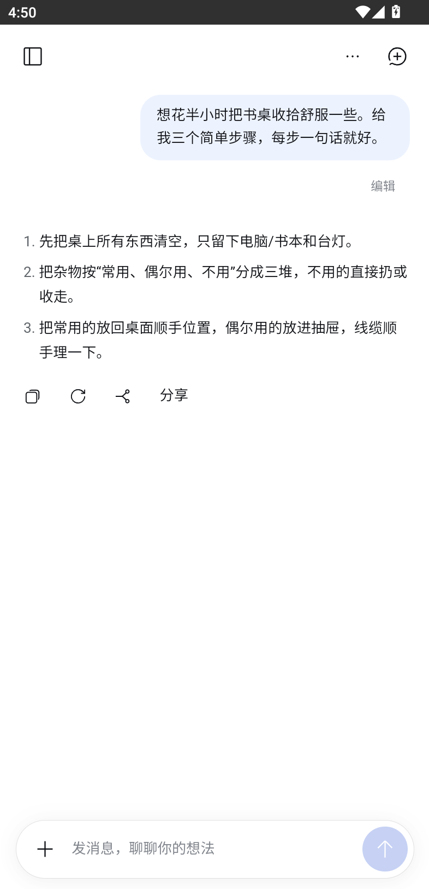
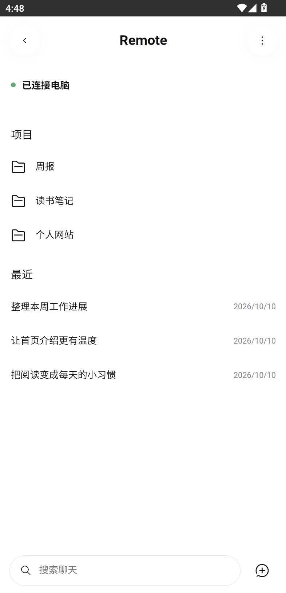
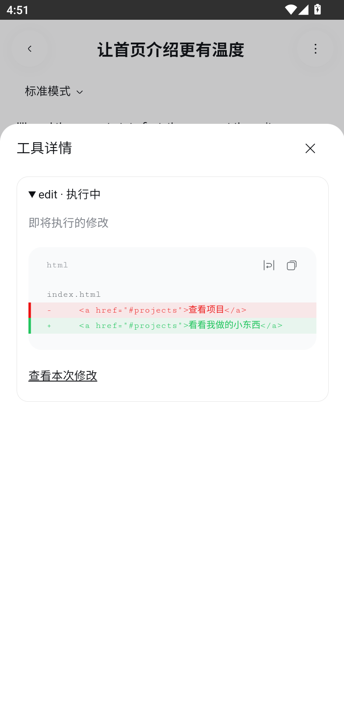
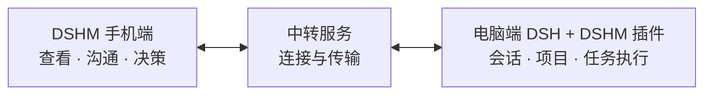

# DeepSeek Harness Mobile (DSHM)

简体中文 | [English](./README.en.md)

**DSHM 安卓客户端** · [DSHM 电脑插件](https://github.com/KKUCODES/dshm-plugin) · [DSHM 中转服务](https://github.com/KKUCODES/dshm-relay)

**DSHM** 是社区开发的 [DeepSeek Harness（DSH）](https://github.com/deepseek-ai/deepseek-harness) 安卓客户端。支持手机直连 DeepSeek 普通聊天，也能同步电脑上的 DSH 会话。离开电脑后，仍能继续发送消息、查看执行结果、切换模型和处理审批；任务由电脑执行。

[下载 Android preview.23](https://github.com/KKUCODES/deepseek-harness-mobile/releases/download/v0.1.0-preview.23/DSHM-0.1.0-preview.23.apk) · [连接电脑 DSH](#连接电脑上的-deepseek-harness) · [使用指南](./docs/usage.md) · [常见问题](#常见问题)

<p align="center">
  
</p>


## 普通聊天与 Remote 界面

<table>
  <tr>
    <th width="33%">聊点日常</th>
    <th width="33%">接着做项目</th>
    <th width="33%">看清再确认</th>
  </tr>
  <tr>
    <td><a href="./docs/images/ordinary-chat.png"></a></td>
    <td><a href="./docs/images/remote-sessions.png"></a></td>
    <td><a href="./docs/images/remote-approval.png"></a></td>
  </tr>
</table>

[图片来源](./docs/images/README.md) · 点击截图看原图。

## 手机聊天与远程会话功能

| 能力 | 内容 |
| --- | --- |
| 普通聊天 | 手机直连 DeepSeek 或自定义 OpenAI Chat Completions 兼容供应商；独立 Key 与模型、流式回复、思考、附件、本地历史与备份。 |
| Remote | 打开已有工作区和会话，在已有工作区新建聊天；发送消息、切换模型、停止任务、回答提问与审批。 |
| 结果查看 | 工具、命令、文件与改动预览；保存或分享完整文件。 |
| 插件界面 | 显示兼容插件；默认等比例缩放，作者声明与用户开关可调整。 |

已发布的 preview.23 APK 预装「Remote 新版首页」0.7.2，提供连接页和首页，可在「插件 → 手机」管理。App 覆盖安装时保留用户选择的插件版本和启停状态。[手机界面插件指南](./docs/plugins/development.md)



## 下载 Android APK 与开始使用

[下载 preview.23 签名 APK](https://github.com/KKUCODES/deepseek-harness-mobile/releases/download/v0.1.0-preview.23/DSHM-0.1.0-preview.23.apk) · [发行页与校验文件](https://github.com/KKUCODES/deepseek-harness-mobile/releases/tag/v0.1.0-preview.23)

在 Android 9 或更高版本上打开下载的 APK，按系统提示安装。若系统询问，允许打开文件的应用安装此 APK。升级已有官方预览版时直接覆盖安装，即可保留聊天、设置和配对。[APK 安装说明](./docs/releases.md)

安装 App 后，配置自己的 DeepSeek Key 即可开始普通聊天；也可在「设置 → 普通聊天 → 管理供应商与模型」添加兼容服务。手机直连所选供应商，聊天历史保存在本地，无需电脑或 Remote 中转服务。

### 连接电脑上的 DeepSeek Harness

1. 在电脑的官方 DSH `0.2.2-rc.3` 中安装 [DSHM 桌面插件 `0.1.88-latest.0`](https://github.com/KKUCODES/dshm-plugin/releases/tag/v0.1.88-latest.0)，重启 DSH Web 加载插件。注册电脑并开启中转连接，点击「生成一次性配对链接」。
2. 在手机 preview.23 中打开「Remote」，扫描电脑上的二维码，或粘贴完整链接。确认设备名称后点击「继续配对」。链接五分钟内有效，只能领取一次。
3. 对照手机与电脑插件显示的设备公钥指纹。一致后在电脑上批准，保持手机 Remote 页面打开，它会自动连接并读取工作区和会话。

**推荐[自建中转](https://github.com/KKUCODES/dshm-relay)**，也可使用[公共服务](http://118.31.20.47:18787)：`http://118.31.20.47:18787`。开放注册免注册密钥，手机仍需配对和批准。

公共服务使用 HTTP，传输未加密。敏感内容建议自建 HTTPS。普通聊天不经过中转。完整步骤见[使用指南](./docs/usage.md)。

## 当前状态

**preview.23** 更新了 Remote 图片和文件预览。图片读取失败时可展开原因，临时错误可单独重试；在文件面板的「面板操作」菜单可下载或分享完整文件。开启工作区分组后，点击首页标题即可进入电脑连接页。[双语发行说明](./ci/release-notes/0.1.0-preview.23.md)

本版 Remote 配套版本为 Android `0.1.0-preview.23`、桌面插件 `0.1.88-latest.0` 和官方 DSH `0.2.2-rc.3`。其他版本按各自的[桌面插件兼容记录](https://github.com/KKUCODES/dshm-plugin/blob/main/compatibility/latest-upstream/official-support.md)核对。

### 历史预览版本

**preview.21** 修复 Remote 历史分页定位竞争、末页位置偏移和发送状态漏判；用户反馈的偶发场景仍待复验。[发行说明](./ci/release-notes/0.1.0-preview.21.md) · [问题诊断](./docs/integration/diagnostics-current.md)

**preview.16** 优化了 Remote 回到前台时的连接恢复，以及重进最近会话时的加载体验，并修复草稿恢复误报。[当前范围与验证](./docs/integration/preview16-remote-resume.md) · [发行说明](./ci/release-notes/0.1.0-preview.16.md) · [构建与下载](./docs/releases.md)

手机界面插件的[公开接口](./docs/plugins/remote-home-api.md)覆盖首页和连接前页面，停用、卸载或失败时使用默认界面。连接页扩展从 preview.15 起提供；开发方法见[插件作者指南](./docs/plugins/development.md)。

**preview.14** 加入独立首页插件与统一手机插件管理，修复手机浅色与电脑深色皮肤混用时的首页配色及原 Figma 图标，保持插件历史读取失败时的官方接口行为。[发行说明](./ci/release-notes/0.1.0-preview.14.md)列出范围与验证边界。

**preview.12** 加入长聊天窗口预算、双向历史查阅、可见区域渲染和故障恢复，电脑历史完整保留；[使用与验证边界](./docs/integration/remote-history-window-current.md)。

**preview.13** 支持[触顶自动加载历史](./docs/integration/remote-history-window-current.md#触顶自动加载)：向上阅读到顶部附近自动加载一批，保留阅读位置及窗口预算；失败仍可手动重试。

修复 Remote 聊天与 Markdown 文件预览的网页链接，交给系统浏览器并保留项目文件预览；[验证范围](./docs/integration/remote-links-diagnosis.md)。这两项修复需要升级 APK，旧页面资源不包含新原生能力。

**preview.11** 统一软件更新入口，以单一状态卡片和主按钮完成下载、安装或「重启并应用」；说明与技术信息折叠，重启前保存草稿，无需去系统设置强行停止。[实现和验证范围](./docs/integration/unified-updates-current.md)。

桌面插件 `0.1.80-latest.0` 和 DSH `0.2.1-alpha.2` 的 Web 与 MuMu 验收见[历史兼容记录](https://github.com/KKUCODES/dshm-plugin/blob/main/compatibility/latest-upstream/official-support.md)。

支持[完整页面资源热更新](./docs/integration/web-resource-updates-current.md)：独立签名与兼容检查、完整启动启用、失败回退及原生恢复入口。涉及原生能力仍需升级 APK；本次只发布 APK，暂不发布 r2。保留此前返回手势、App 内更新及长聊天修复；preview.8 起可在 App 内更新，更早版本请手动覆盖安装。

旧版 DSH 的兼容依据见[历史版本记录](./docs/integration/market-baseline.md)。普通聊天的自定义供应商与模型见[模型服务说明](./docs/integration/ordinary-providers-current.md)。

### 平台与 Remote 使用范围

- 首版仅 Android。真机、完整公网链路及其他版本、插件、模型仍需验证。
- 电脑和 DSH 保持运行，只安装独立插件，不修改 DSH 本体。
- 手机不创建电脑工作区、不输入命令、不转发电脑 localhost 网站。
- App 进程结束后不推送；重新打开尝试重连。

## 常见问题

### 如何查看排障日志？

进入「设置 → 问题诊断」，或在 Remote 会话菜单打开「实时日志」。点错误行可查看并复制脱敏详情。排障与发布包栈还原见[问题诊断](./docs/integration/diagnostics-current.md)。

### Remote 与手机浏览器打开 DSH 有什么区别？

Remote 使用随 App 打包的 DSHM 聊天界面，通过中转同步电脑会话与操作。手机能在自己的页面查看执行过程、文件改动和审批；电脑端 DSH 负责执行任务，手机与电脑共同参与同一个会话。

### 连接 Remote 需要在手机填写 DeepSeek Key 吗？

不需要填写手机普通聊天的 Key。Remote 使用电脑 DSH 配置的模型与凭据，手机需要配对并获得电脑批准。普通聊天则使用你在手机配置的供应商 API Key，两种模式分别管理。

### 普通聊天与 Remote 的历史保存在哪里？

普通聊天历史和草稿保存在手机，可通过本地备份导出；Remote 对接电脑 DSH 保存的会话。两者分别管理，切换模式不会合并聊天历史。详细步骤见[历史与备份](./docs/usage.md#历史与备份)。

### 有 iPhone 版吗？

目前只提供 Android 开发预览，最低 Android 9；尚未提供 iPhone 版本。

## 开发与文档

Kotlin + WebView，React 聊天界面复用 DSH 客户端组件，页面随 App 打包。GitHub Actions 自动准备固定 SDK 与只读官方源码；原本地开发入口仍使用相邻项目，见[构建说明](./docs/releases.md)。

```text
android/     Android 工程与原生桥
src/         普通聊天、Remote 和共享界面
scripts/     构建、检查和联调脚本
tests/       测试与夹具
docs/        使用、开发与技术文档
```

- [使用指南](./docs/usage.md)：普通聊天、配对与限制。
- [开发指南](./docs/development.md)：环境、构建与测试。
- [Remote 缓存](./docs/integration/remote-cache-current.md)记录缓存机制及其首次交付时的验收范围。
- [构建与下载](./docs/releases.md)：自动签名、公开 APK、摘要与版本信息。
- [App 内更新](./docs/integration/app-updates-current.md)：检查、下载和系统覆盖安装，支持 Markdown 更新说明与具体校验错误提示。
- [兼容结论](https://github.com/KKUCODES/dshm-plugin/blob/main/compatibility/latest-upstream/official-support.md)：版本与支持范围。
- [知识库](./docs/project-knowledge/catalog.md)：架构、设计与验证资料。
