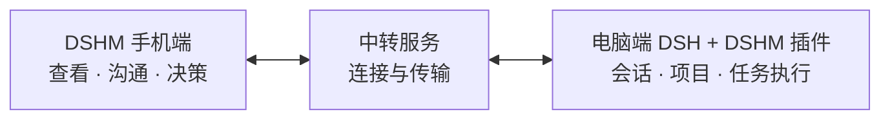

# DeepSeek Harness Mobile (DSHM)

简体中文 | [English](./README.en.md)

**DSHM 安卓客户端** · [DSHM 电脑插件](https://github.com/KKUCODES/dshm-plugin) · [DSHM 中转服务](https://github.com/KKUCODES/dshm-relay)

**DSHM** 是社区开发的 [DeepSeek Harness（DSH）](https://github.com/deepseek-ai/deepseek-harness) 安卓客户端。支持手机直连 DeepSeek 普通聊天，也能同步电脑上的 DSH 会话。离开电脑后，仍能继续发送消息、查看执行结果、切换模型和处理审批；任务由电脑执行。

[下载 Android APK](https://github.com/KKUCODES/deepseek-harness-mobile/releases/download/v0.1.0-preview.10/DSHM-0.1.0-preview.10.apk) · [连接电脑 DSH](#连接电脑上的-deepseek-harness) · [使用指南](./docs/usage.md) · [常见问题](#常见问题)

<p align="center">
  
</p>


## 普通聊天与 Remote 界面

<table>
  <tr>
    <th width="33%">聊点日常</th>
    <th width="33%">接着做项目</th>
    <th width="33%">看清再确认</th>
  </tr>
  <tr>
    <td><a href="./docs/images/ordinary-chat.png"></a></td>
    <td><a href="./docs/images/remote-sessions.png"></a></td>
    <td><a href="./docs/images/remote-approval.png"></a></td>
  </tr>
</table>

[图片来源](./docs/images/README.md) · 点击截图看原图。

## 手机聊天与远程会话功能

| 能力 | 内容 |
| --- | --- |
| 普通聊天 | 手机直连 DeepSeek 或自定义 OpenAI Chat Completions 兼容供应商；独立 Key 与模型、流式回复、思考、附件、本地历史与备份。 |
| Remote | 打开已有工作区和会话，在已有工作区新建聊天；发送消息、切换模型、停止任务、回答提问与审批。 |
| 结果查看 | 工具、命令、文件与改动预览；保存或分享完整文件。 |
| 插件界面 | 显示兼容插件；默认等比例缩放，作者声明与用户开关可调整。 |



## 下载 Android APK 与开始使用

[APK 发行版本](https://github.com/KKUCODES/deepseek-harness-mobile/releases) · [构建与签名说明](./docs/releases.md) · [GitHub Actions 构建](https://github.com/KKUCODES/deepseek-harness-mobile/actions/workflows/android-build.yml)

公开开发预览提供已签名 APK，最低 Android 9。可直接从 Release 下载 `.apk` 安装，无需登录 GitHub；Actions 中的 `dshm-signed-apk` 下载需要登录。签名与更新说明见[APK 构建与下载指南](./docs/releases.md)。

安装 App 后，配置自己的 DeepSeek Key 即可开始普通聊天；也可在「设置 → 普通聊天 → 管理供应商与模型」添加兼容服务。手机直连所选供应商，聊天历史保存在本地，无需电脑或 Remote 中转服务。

### 连接电脑上的 DeepSeek Harness

1. 在电脑的官方 DSH 中安装[DSHM 远程连接插件](https://github.com/KKUCODES/dshm-plugin)，连接中转服务。
2. 在手机 DSHM 中领取电脑生成的一次性配对链接。
3. 电脑核对设备指纹并批准后，手机打开已有工作区，继续会话或创建新聊天。

**推荐[自建中转](https://github.com/KKUCODES/dshm-relay)**，也可使用[公共服务](http://118.31.20.47:18787)：`http://118.31.20.47:18787`。开放注册免注册密钥，手机仍需配对和批准。

公共服务使用 HTTP，传输未加密。敏感内容建议自建 HTTPS。普通聊天不经过中转。完整步骤见[使用指南](./docs/usage.md)。

## 当前状态

开发预览，尚未进入应用商店。核心 Remote 已在 **官方 DSH `0.2.1-alpha.2`＋插件 `0.1.80-latest.0`＋配套 Android** 上完成 Web + MuMu 本地验收；扩展范围见[兼容结论](https://github.com/KKUCODES/dshm-plugin/blob/main/compatibility/latest-upstream/official-support.md)。

**preview.10** 新增[完整页面资源热更新](./docs/integration/web-resource-updates-current.md)：独立签名与兼容检查、下次完整启动启用、失败回退及原生恢复入口。先升级本版 APK 一次，之后可接收兼容的页面更新；涉及原生能力仍需升级 APK。保留此前返回手势、App 内更新及长聊天修复；preview.8 起可在 App 内更新，更早版本请手动覆盖安装。

[0.1.0-preview.10](https://github.com/KKUCODES/deepseek-harness-mobile/releases/tag/v0.1.0-preview.10) 保留普通聊天自定义供应商和模型、原 DeepSeek 配置与聊天；[模型服务说明](./docs/integration/ordinary-providers-current.md)。Remote 配套电脑插件 `0.1.87-latest.0`，核心连接已验官方 DSH `0.2.0-rc.2` / `0.2.1-alpha.2` / `0.2.1-rc.2`；[版本验证范围](./docs/integration/market-baseline.md)。沿用原身份和签名，可覆盖 preview.1–preview.9，保留本地数据；本版无需额外升级插件或中转。

- 首版仅 Android。真机、完整公网链路及其他版本、插件、模型仍需验证。
- 电脑和 DSH 保持运行，只安装独立插件，不修改 DSH 本体。
- 手机不创建电脑工作区、不输入命令、不转发电脑 localhost 网站。
- App 进程结束后不推送；重新打开尝试重连。

## 常见问题

### Remote 与手机浏览器打开 DSH 有什么区别？

Remote 使用随 App 打包的 DSHM 聊天界面，通过中转同步电脑会话与操作。手机能在自己的页面查看执行过程、文件改动和审批；电脑端 DSH 负责执行任务，手机与电脑共同参与同一个会话。

### 连接 Remote 需要在手机填写 DeepSeek Key 吗？

不需要填写手机普通聊天的 Key。Remote 使用电脑 DSH 配置的模型与凭据，手机需要配对并获得电脑批准。普通聊天则使用你在手机配置的供应商 API Key，两种模式分别管理。

### 普通聊天与 Remote 的历史保存在哪里？

普通聊天历史和草稿保存在手机，可通过本地备份导出；Remote 对接电脑 DSH 保存的会话。两者分别管理，切换模式不会合并聊天历史。详细步骤见[历史与备份](./docs/usage.md#历史与备份)。

### 有 iPhone 版吗？

目前只提供 Android 开发预览，最低 Android 9；尚未提供 iPhone 版本。

## 开发与文档

Kotlin + WebView，React 聊天界面复用 DSH 客户端组件，页面随 App 打包。GitHub Actions 自动准备固定 SDK 与只读官方源码；原本地开发入口仍使用相邻项目，见[构建说明](./docs/releases.md)。

```text
android/     Android 工程与原生桥
src/         普通聊天、Remote 和共享界面
scripts/     构建、检查和联调脚本
tests/       测试与夹具
docs/        使用、开发与技术文档
```

- [使用指南](./docs/usage.md)：普通聊天、配对与限制。
- [开发指南](./docs/development.md)：环境、构建与测试。
- [Remote 缓存](./docs/integration/remote-cache-current.md)：资源校验、增量同步与实测范围；需配套插件 0.1.85-latest.0，现有中转无需升级。
- [构建与下载](./docs/releases.md)：自动签名、公开 APK、摘要与版本信息。
- [App 内更新](./docs/integration/app-updates-current.md)：检查、下载和系统覆盖安装，支持 Markdown 更新说明与具体校验错误提示。
- [兼容结论](https://github.com/KKUCODES/dshm-plugin/blob/main/compatibility/latest-upstream/official-support.md)：版本与支持范围。
- [知识库](./docs/project-knowledge/catalog.md)：架构、设计与验证资料。
