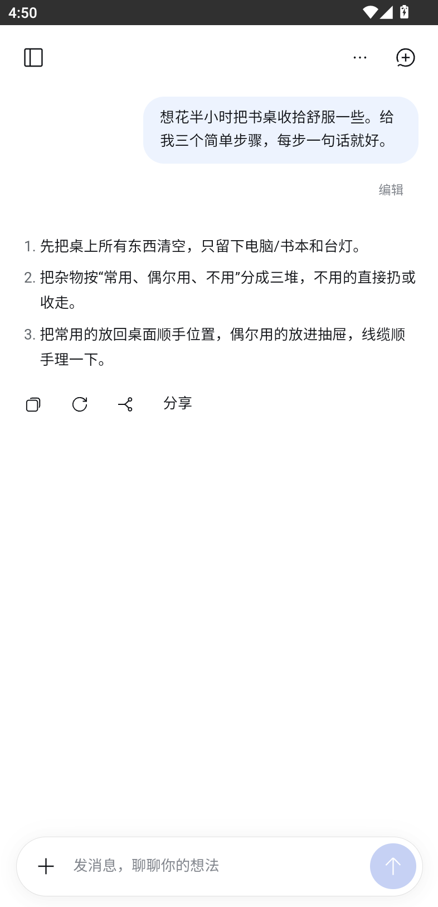
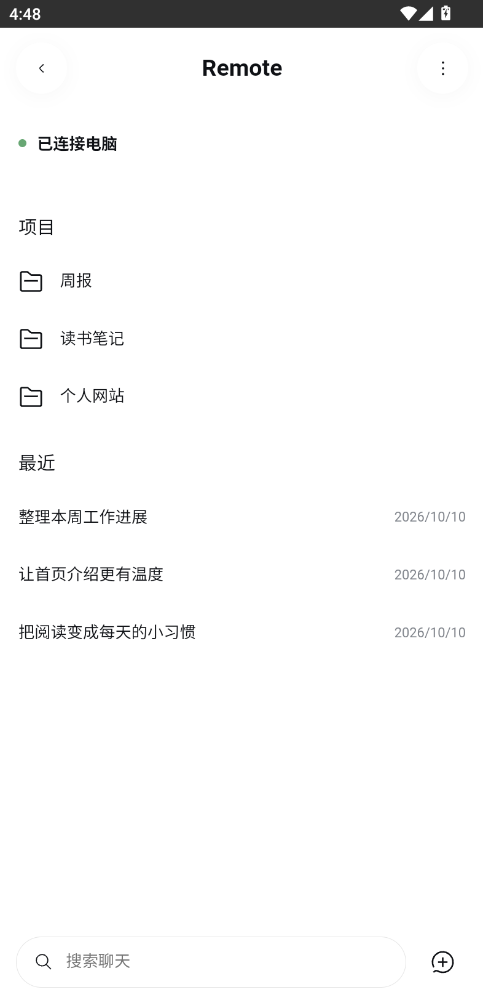
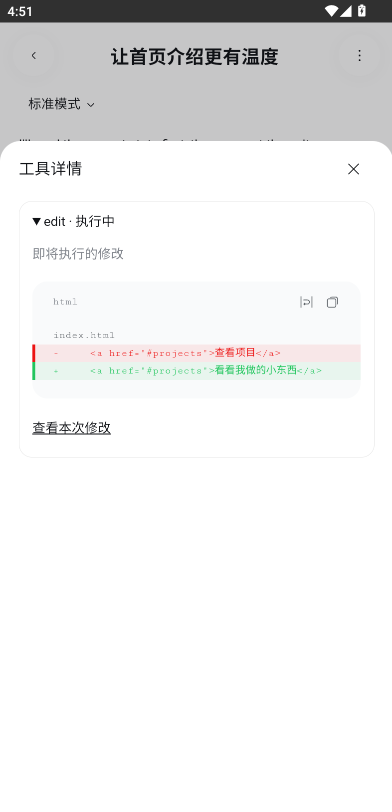
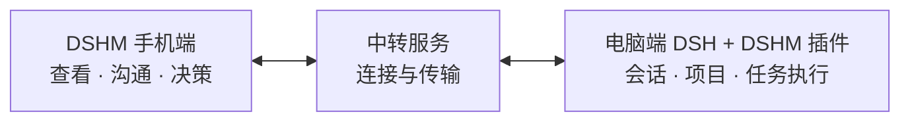

# DSHM

简体中文 | [English](./README.en.md)

**手机端** · [电脑插件](https://github.com/KKUCODES/dshm-plugin) · [中转服务](https://github.com/KKUCODES/dshm-relay)

<p align="center">
  
</p>


Android 聊天客户端。用自己的 DeepSeek Key 随手聊，也能连接电脑上的 DSH，继续同一个会话。任务由电脑执行，手机查看、沟通、决策。

## 界面

<table>
  <tr>
    <th width="33%">聊点日常</th>
    <th width="33%">接着做项目</th>
    <th width="33%">看清再确认</th>
  </tr>
  <tr>
    <td><a href="./docs/images/ordinary-chat.png"></a></td>
    <td><a href="./docs/images/remote-sessions.png"></a></td>
    <td><a href="./docs/images/remote-approval.png"></a></td>
  </tr>
</table>

[图片来源](./docs/images/README.md) · 点击截图看原图。

## 功能

| 能力 | 内容 |
| --- | --- |
| 普通聊天 | 手机直连 DeepSeek；流式回复、深度思考、附件、本地历史与备份。 |
| Remote | 打开已有工作区和会话，在已有工作区新建聊天；发送消息、切换模型、停止任务、回答提问与审批。 |
| 结果查看 | 工具、命令、文件与改动预览；保存或分享完整文件。 |
| 插件界面 | 显示兼容插件；默认等比例缩放，作者声明与用户开关可调整。 |



## 开始使用

[APK 构建与下载](./docs/releases.md) · [GitHub Actions](https://github.com/KKUCODES/dshm/actions/workflows/android-build.yml) · [发行版本](https://github.com/KKUCODES/dshm/releases)

- **普通聊天：** 安装 App，配置自己的 DeepSeek Key。历史保存在手机，无需电脑。
- **Remote：** 电脑安装[配套插件](https://github.com/KKUCODES/dshm-plugin)，连接中转；手机领取一次性链接，电脑核对指纹并批准。

**推荐[自建中转](https://github.com/KKUCODES/dshm-relay)**，也可使用[公共服务](http://118.31.20.47:18787)：`http://118.31.20.47:18787`。开放注册免注册密钥，手机仍需配对和批准。

公共服务使用 HTTP，传输未加密。敏感内容建议自建 HTTPS。普通聊天不经过中转。完整步骤见[使用指南](./docs/usage.md)。

## 当前状态

开发候选，尚未正式发布。核心 Remote 已在 **官方 DSH `0.2.1-alpha.2`＋插件 `0.1.80-latest.0`＋配套 Android** 上完成 Web + MuMu 本地验收；扩展范围见[兼容结论](https://github.com/KKUCODES/dshm-plugin/blob/main/compatibility/latest-upstream/official-support.md)。

- 首版仅 Android。真机、完整公网链路及其他版本、插件、模型仍需验证。
- 电脑和 DSH 保持运行，只安装独立插件，不修改 DSH 本体。
- 手机不创建电脑工作区、不输入命令、不转发电脑 localhost 网站。
- App 进程结束后不推送；重新打开尝试重连。

## 开发与文档

Kotlin + WebView，React 聊天界面复用 DSH 客户端组件，页面随 App 打包。GitHub Actions 自动准备固定 SDK 与只读官方源码；原本地开发入口仍使用相邻项目，见[构建说明](./docs/releases.md)。

```text
android/     Android 工程与原生桥
src/         普通聊天、Remote 和共享界面
scripts/     构建、检查和联调脚本
tests/       测试与夹具
docs/        使用、开发与技术文档
```

- [使用指南](./docs/usage.md)：普通聊天、配对与限制。
- [开发指南](./docs/development.md)：环境、构建与测试。
- [下载与发版](./docs/releases.md)：Actions 安装包、签名与发行草稿。
- [兼容结论](https://github.com/KKUCODES/dshm-plugin/blob/main/compatibility/latest-upstream/official-support.md)：版本与支持范围。
- [知识库](./docs/project-knowledge/catalog.md)：架构、设计与验证资料。
